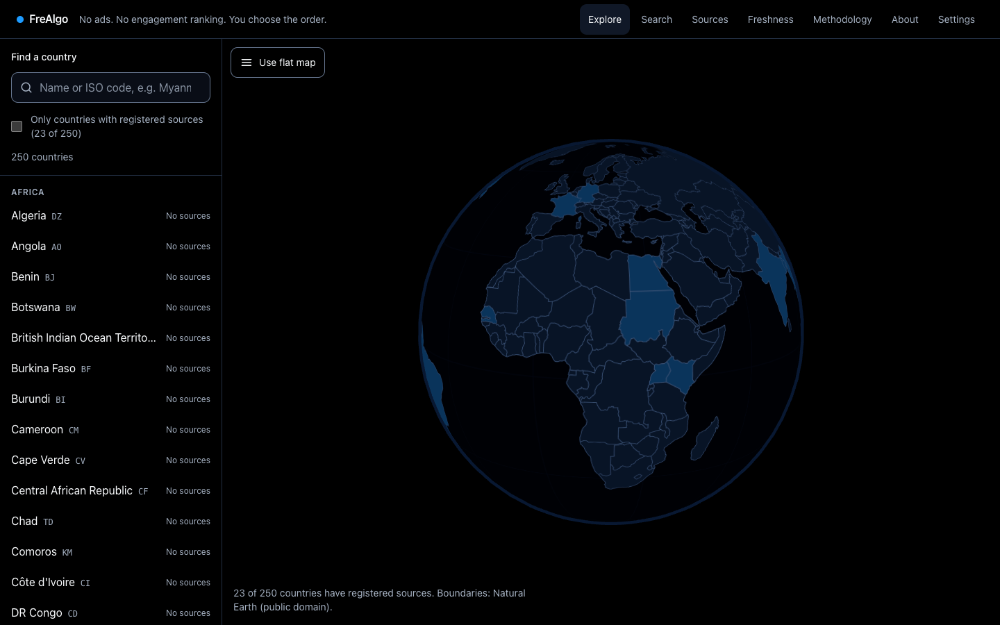
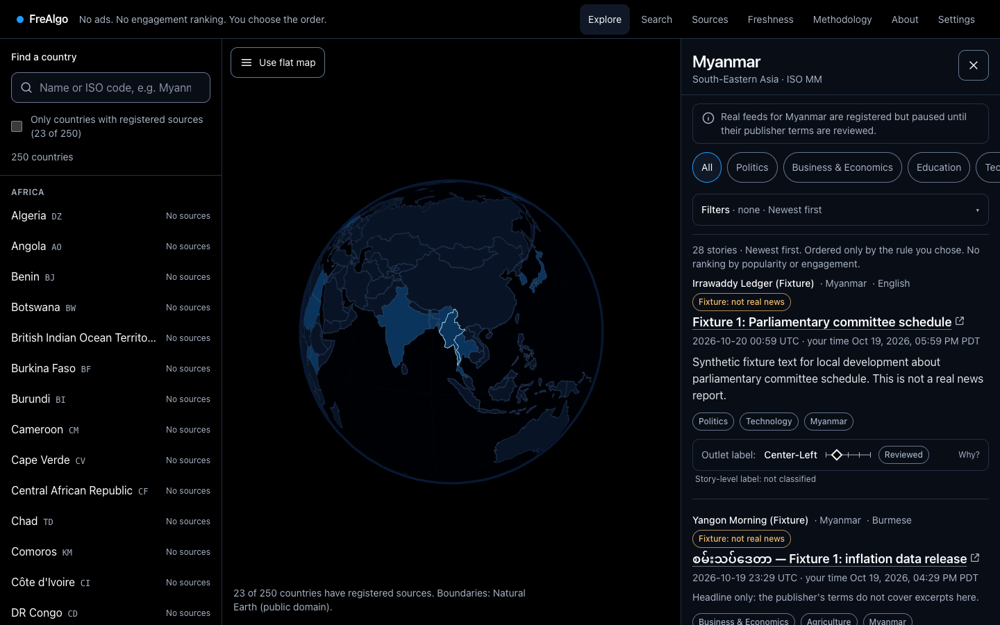
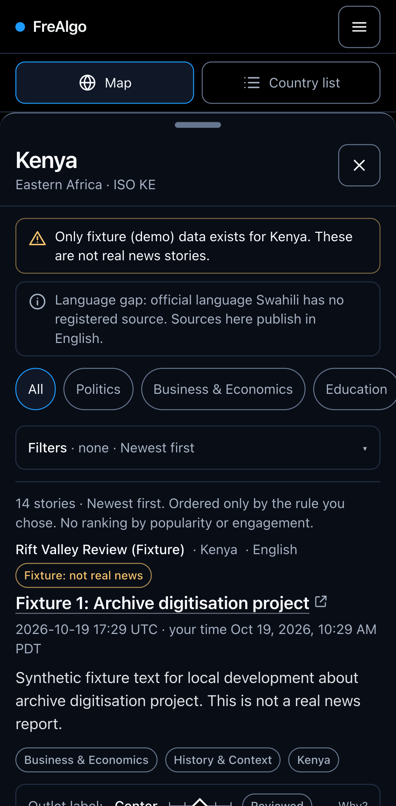
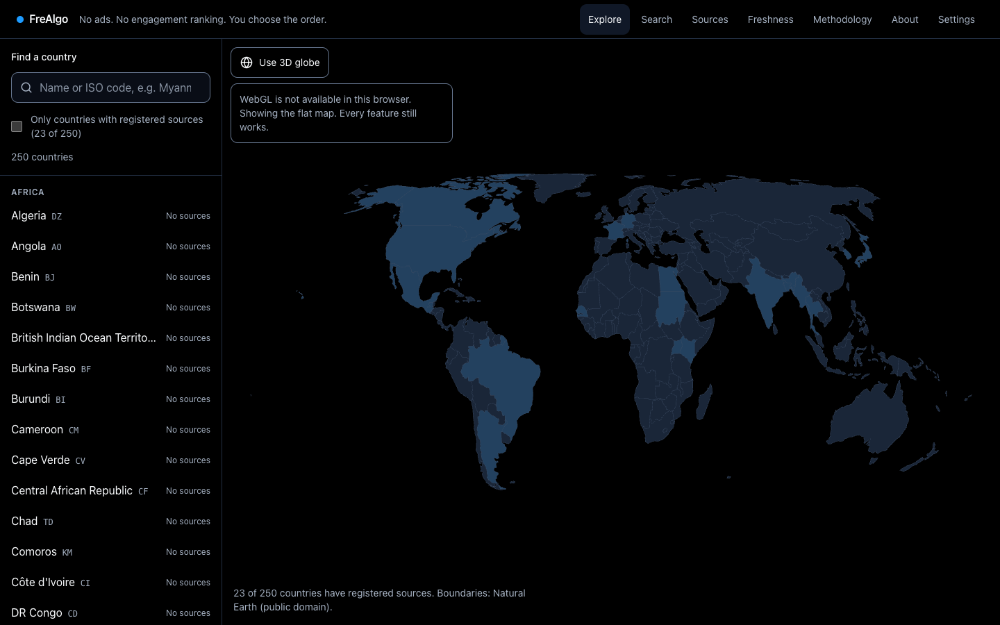
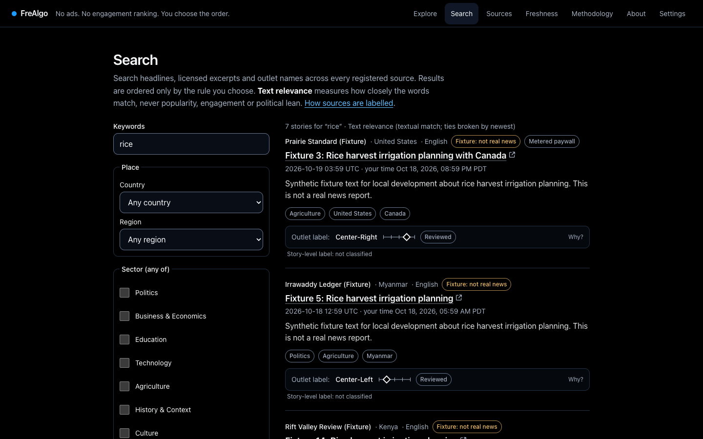
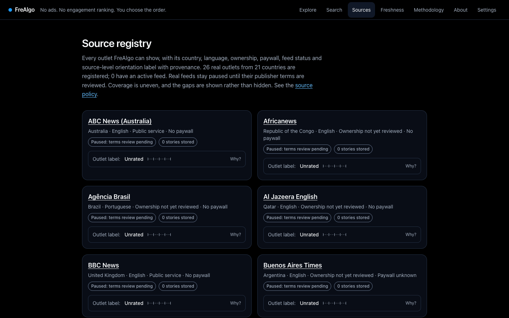
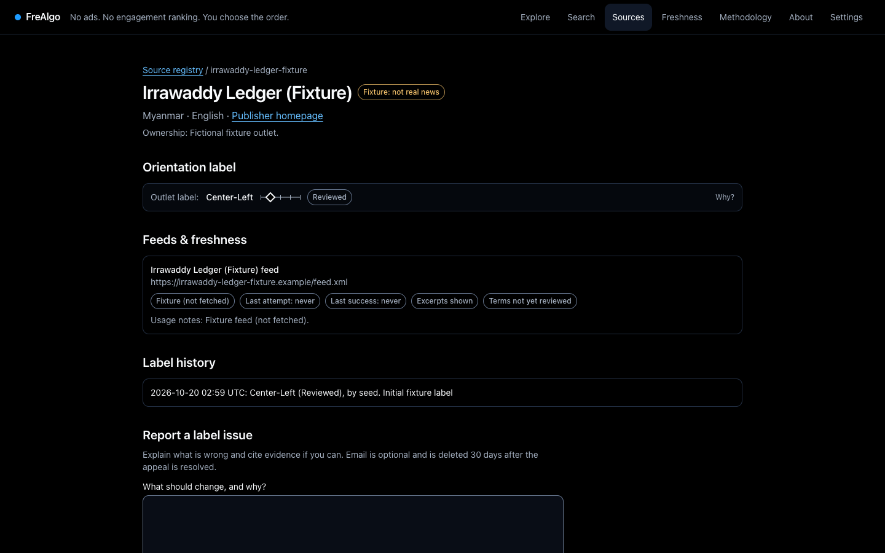
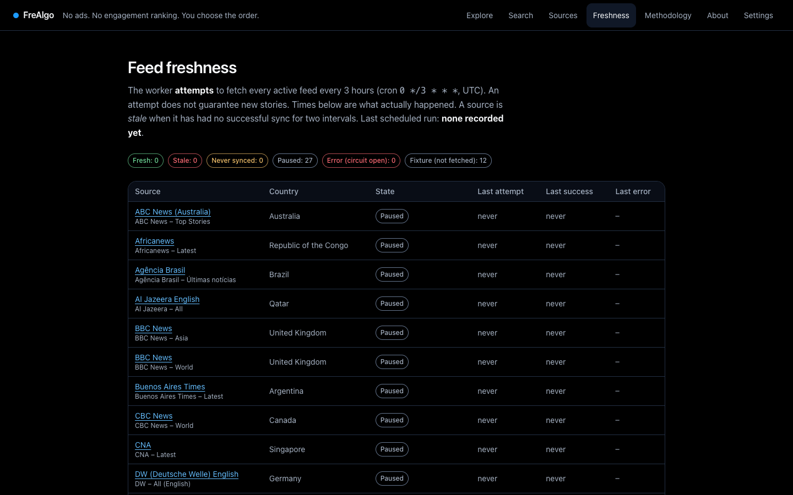
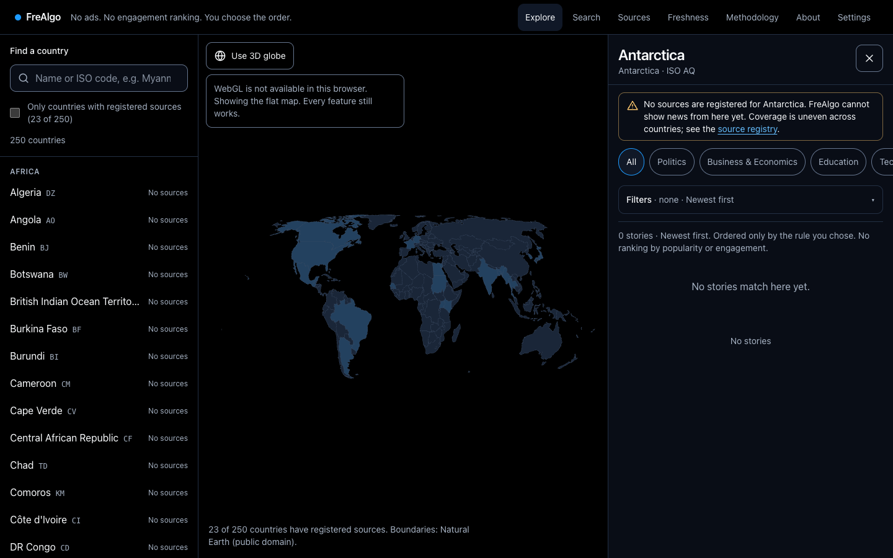

# Release readiness report: FreAlgo v1

Date: 2026-10-20 · Repository: <https://github.com/Wai-999/FreAlgo> (`main`, CI green)

## 0. Deployment record (2026-10-21)

**Live at <https://frealgo.duckdns.org>.**

- **Host:** Oracle Cloud Always Free, Ampere A1 (2 OCPU, 12 GB, Ubuntu 24.04 ARM), region
  us-sanjose-1.
- **Recipe:** `deploy/docker-compose.prod.yml` via `scripts/ops/deploy-remote.sh` (Caddy with a
  Let's Encrypt certificate, private Postgres and Redis, least-privilege app role).
- **Sources:** NPR, BBC News and Agência Brasil active per the owner's terms review
  (`deploy/source-activations.json`); all other feeds paused. No fixture data in production.
- **Verified on the public URL:** `scripts/ops/smoke.sh` passed (11/11). HSTS, CSP and frame
  headers are present; `/api/v1/metrics` returns 404 publicly; HTTP redirects to HTTPS; first
  fetch completed (4 feeds fresh, 0 errors).
- **Backups:** nightly at 02:37 UTC on the server, newest 7 kept; `scripts/ops/pull-backups.sh`
  copies them off the server. Restore drill passed on production data (2026-10-21).
- **Not yet set up:** uptime monitoring, OIDC sign-in.

## 1. Status in one paragraph

All five milestones are implemented and validated, and the site is deployed (§0). Every gate
passes, locally and on GitHub Actions: format, lint, typecheck, unit, integration, production
build, cross-browser e2e, and Docker builds. The scheduled worker was observed ingesting real
publisher feeds end to end, and the restore drill passes. Remaining external items are in §8.

## 2. Commits

| Commit    | Scope                                                       |
| --------- | ----------------------------------------------------------- |
| `86305a1` | Implementation specification                                |
| `b3cf992` | M1: foundation, data model, design system, one-command boot |
| `df0a43e` | M2: reliable ingestion and source governance                |
| `c1fb436` | M3: news APIs, search, country workspace                    |
| `516b2fc` | M4: interactive globe and polished responsive UX            |
| `f521cb5` | M5: production hardening, release and handover              |

## 3. Milestone 5 acceptance

| Criterion                                              | Evidence                                                                                                                                                                                                                                                                                                                                                                                                                          | Result |
| ------------------------------------------------------ | --------------------------------------------------------------------------------------------------------------------------------------------------------------------------------------------------------------------------------------------------------------------------------------------------------------------------------------------------------------------------------------------------------------------------------- | ------ |
| Lint, typecheck, unit, integration, e2e and build pass | §5                                                                                                                                                                                                                                                                                                                                                                                                                                | ✅     |
| Zero known critical vulnerabilities                    | `npm audit --omit=dev`: 0 vulnerabilities. Full tree: 0 critical; one high advisory in dev-only lint tooling (`braces` via `eslint-config-next`), accepted in `docs/security-review.md`. CI enforces both                                                                                                                                                                                                                         | ✅     |
| Restore drill succeeds                                 | `scripts/ops/restore-drill.sh` → `reports/restore-drill.txt`: per-table row counts and migration state identical after restore                                                                                                                                                                                                                                                                                                    | ✅     |
| Scheduled worker observed                              | `reports/observe-scheduler.txt`. The real worker ran with a 1-minute cron against the throwaway test DB, with 3 real outlets (4 feeds) activated **there only**. The first tick enqueued 4 jobs (`trigger=schedule`), inserting 32 + 17 (BBC), 134 (DW) and 10 (Agência Brasil) real stories. The next two ticks correctly enqueued nothing, as the window had already been attempted. 0 failures, 0 DLQ, fetch success ratio 1.0 | ✅     |
| Source freshness and provenance visible                | `/status` (scheduler, per-source freshness), source pages (terms status, label history, methodology, reviewer, date), labels on every story; screenshots 07 and 08                                                                                                                                                                                                                                                                | ✅     |
| Mobile and desktop smoke tests pass                    | `scripts/ops/smoke.sh` against the rebuilt Compose stack: `SMOKE PASSED` (11 checks). e2e runs on desktop Chromium, Firefox and WebKit, and mobile Chromium (Pixel 7) and WebKit (iPhone 14)                                                                                                                                                                                                                                      | ✅     |
| External secrets and hosting gates listed              | §8                                                                                                                                                                                                                                                                                                                                                                                                                                | ✅     |

Milestone 5 also delivered:

- Security review: three vulnerabilities fixed, details in `docs/security-review.md`.
- Licence audit.
- Observability: logs, `Server-Timing`, metrics, alert table.
- Production Compose recipe, with Caddy TLS and least-privilege roles.
- Backup and restore scripts.
- Query plans at 200 000 articles.
- Load test.
- Privacy and accessibility audit.
- Operations runbook and deployment checklist.

## 4. Issues found and fixed during hardening

| Found by              | Issue                                                                                                                                                                            | Fix                                                                                                              |
| --------------------- | -------------------------------------------------------------------------------------------------------------------------------------------------------------------------------- | ---------------------------------------------------------------------------------------------------------------- |
| Security review       | Stored XSS: admin URLs accepted `javascript:`/`data:`                                                                                                                            | http(s)-only validation and `safeHref()` on every rendered external link                                         |
| Security review       | robots.txt patterns could cause super-linear matching (ReDoS)                                                                                                                    | Pattern length and wildcard caps                                                                                 |
| Security review       | Map SVG served without its own CSP                                                                                                                                               | Restrictive CSP and `nosniff` on `/geo/*`                                                                        |
| EXPLAIN at 200k rows  | Broad search 590 ms; selective search 518 ms (full scans); country-scoped search 341–401 ms                                                                                      | ADR-019: ~200 ms / 3 ms / 27–36 ms                                                                               |
| EXPLAIN at 200k rows  | Sector filter misestimated 70× and scanned every tag                                                                                                                             | Resolve slugs to ids: 48 → 14 ms                                                                                 |
| Load test             | Postgres `/dev/shm` exhaustion under concurrency (36 × HTTP 500)                                                                                                                 | `shm_size: 256mb` in both compose files                                                                          |
| Load test             | Cold-cache stampede on the country summary                                                                                                                                       | Single-flight SWR loads (+ unit tests)                                                                           |
| a11y sweep            | Settings overflowed 115 px at 320 px (WCAG 1.4.10)                                                                                                                               | `fieldset`/`select` min-size fix; reflow test for 10 pages                                                       |
| Screenshots           | 2D map drawn on a white box (iframe color-scheme mismatch)                                                                                                                       | `color-scheme: dark` in the SVG; asset bumped to v2 (ADR-021)                                                    |
| Scheduler observation | Ops script broke on `.env` values with spaces                                                                                                                                    | Reads only the needed variable                                                                                   |
| Resilience review     | If the lazily loaded globe chunk failed to download (offline, flaky network, or a deploy removing old chunks), the whole Explore page crashed; `globe_load_error` was never sent | Error boundary → flat-map fallback + counter. A new e2e test fails without the fix (verified) and passes with it |

## 5. Test evidence (final run)

```
npm run format:check   → All matched files use Prettier code style
npm run lint           → 0 problems (--max-warnings=0)
npm run typecheck      → 0 errors
npm test               → 20 files, 194 tests passed
npm run test:integration → 6 files, 81 tests passed (Postgres 17 + Redis 8, *_test DB)
npm run build          → production standalone build OK
npx playwright test    → 144 tests on 5 projects: 118 passed, 26 skipped by design (engine- or viewport-specific), 0 failed, 0 flaky
scripts/ops/smoke.sh   → SMOKE PASSED (Compose stack)
```

The e2e suite covers:

- welcome skip and reduced motion;
- search and filters;
- country navigation by map, list and keyboard;
- panel accessibility (focus trap, Escape, focus return);
- finite pagination;
- source attribution links;
- small screens and 320 px reflow;
- WebGL unavailable on every engine;
- 3D globe interactions (SwiftShader);
- the no-JavaScript path;
- slow network: countries and stories usable before any script arrives (all engines);
- offline or flaky network: a globe download failure falls back to the flat map;
- governance (admin auth, terms gate);
- axe WCAG 2.2 AA scans of every page.

## 6. Performance summary (details in `docs/performance.md`)

- **Lighthouse** (simulated mobile): home 92, country sheet 95, search 99. Accessibility 100.
  LCP 2.8 s against a 2.5 s target (gap, see §7).
- **Globe:** zero frames while idle. 60 fps median in emulated phones; ~30 fps on a GPU-less
  desktop under SwiftShader (worst case). Lazy chunk ~250 KB gzipped, loaded only when idle.
- **API at 200 000 articles, 20 concurrent clients:**
  - cached and index-served reads: p97.5 8–42 ms;
  - explore HTML: p97.5 218 ms;
  - broad relevance search: p97.5 545 ms;
  - 107 876 requests, 0 errors.

## 7. Known limitations (honest list)

1. **Real feeds are paused by default.** They need an operator's terms review (deliberate, see
   `docs/source-policy.md`). Coverage is uneven: 26 real outlets are registered, and most
   countries have none. The UI states this per country.
2. **Outlet labels for real sources are "Unrated".** No licensed third-party rating dataset was
   used, and labels are never inferred automatically. Fixture outlets demonstrate the full label
   and provenance flow.
3. **Sector tagging is rule-based and English-first** (rules v1). Other languages rely on feed
   categories and defaults; every tag shows its basis.
4. **Simulated mobile LCP is 2.8 s** against a 2.5 s target. The next step is less client
   JavaScript on `/`.
5. **Broad relevance search under sustained concurrency** reaches p97.5 545 ms against a 500 ms
   budget. It scales with match count; next steps are in `docs/performance.md`.
6. **In-process caches and API metrics are per web instance.**
7. **Not done without real hardware or people:**
   - physical low-end Android and iOS Safari testing;
   - screen-reader testing (VoiceOver, NVDA, TalkBack);
   - an independent penetration test.
8. **Dark theme only.**

## 8. External gates (need the operator: accounts, money or legal decisions)

| Gate                                    | Needed for                                                             | What to do                                                                                                                                  |
| --------------------------------------- | ---------------------------------------------------------------------- | ------------------------------------------------------------------------------------------------------------------------------------------- |
| Git remote + hosted CI                  | Running `.github/workflows/ci.yml`, branch protection, dependency bots | Create the repository, push `build/frealgo-v1`, open a PR                                                                                   |
| Hosting + domain + DNS                  | Production deployment                                                  | Follow `docs/deployment-checklist.md` §A                                                                                                    |
| Secrets                                 | Production                                                             | Generate with `openssl rand -base64 48`, store in a secret manager                                                                          |
| OIDC identity provider                  | Server-side preference sync, operator sign-in                          | Register a client; set `OIDC_*` and `ADMIN_USER_IDS`                                                                                        |
| **Publisher terms review**              | Showing real news                                                      | Per feed: review terms and robots, then `npm run sources:activate` with notes. 27 feeds were dry-run verified as parseable (nothing stored) |
| Licensed news APIs                      | Coverage beyond RSS/Atom                                               | Adapter interface exists (`workers/providers/licensed-json.ts`); needs keys, cost and licence review                                        |
| Third-party bias-rating dataset         | Non-"Unrated" labels for real outlets                                  | Licence review; import with methodology, source URL and review date                                                                         |
| Legal review                            | Privacy notice and controller identity for the jurisdiction            | Fill in `/privacy`                                                                                                                          |
| Physical devices, AT users, pen-testers | Items in §7.7                                                          | Schedule before public launch                                                                                                               |

## 9. Next actions (priority order)

1. Push to a remote and run hosted CI; open the PR for review.
2. Choose hosting and deploy with the production recipe, then run the deployment checklist.
3. Review terms for an initial set of feeds (prioritise countries with no coverage) and activate
   them. Watch `/status` through two schedule windows.
4. Physical-device and screen-reader testing, then fix findings.
5. Reduce client JavaScript on `/` to close the LCP gap.
6. Decide on a licensed rating dataset, or an in-house reviewed labelling process with published
   methodology.
7. Add a container image scan to CI (Dependabot is already active on GitHub).

## 10. Decisions the product does not conceal

- Coverage is uneven across countries and languages. Every country page says what is missing.
- Political orientation is source-level, context-dependent and disputed. Labels carry status,
  methodology, reviewer, date and history, and stories are never labelled from their outlet.
- The 3-hour schedule requires an always-on worker. Never run it inside a sleeping web instance.
- Personalisation is explicit preferences only; there is no behavioural ranking anywhere.
- Third-party APIs, map assets and images went through licence review: images are not shown;
  map data is public domain (`docs/licenses.md`).

## 11. Screenshots (`docs/screenshots/`, fixture data badged in the UI)

|                                                                                             |                                                                                                     |
| ------------------------------------------------------------------------------------------- | --------------------------------------------------------------------------------------------------- |
|  Desktop 3D globe                         |  Country sheet with labels and provenance |
|  Mobile sheet with coverage notices |  No-WebGL 2D fallback                         |
|  Search with transparent ordering               |  Source registry                                      |
|  Label provenance and history  |  Scheduler and freshness                              |
|  A country with no sources                  |                                                                                                     |

Regenerate with `node scripts/ops/screenshots.mjs` against a running production build.
